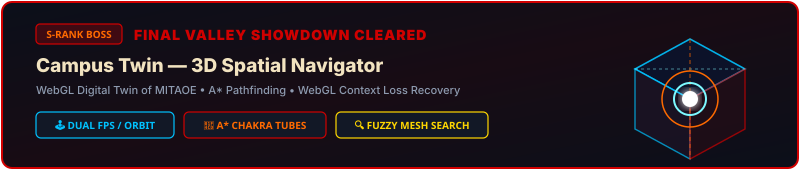

  

  

  

  

<code>[ <a href="#idcard">🥷</a> ] &nbsp; [ <a href="#jutsu">📜</a> ] &nbsp; [ <a href="#missions">🎯</a> ] &nbsp; [ <a href="#finalvalley">⚡</a> ] &nbsp; [ <a href="#stats">🏆</a> ] &nbsp; [ <a href="#strike">💥</a> ] &nbsp; [ <a href="#journey">🗺️</a> ] &nbsp; [ <a href="#contact">🦅</a> ] &nbsp; [ <a href="#top">▲</a> ]</code>

  

 

  

 

  

  

 

<table align="center" border="0" cellpadding="6" cellspacing="0">
  <tr>
    <td align="center">
      
    </td>
    <td align="center">
      
    </td>
  </tr>
  <tr>
    <td align="center">
      
    </td>
    <td align="center">
      
    </td>
  </tr>
  <tr>
    <td align="center">
      
    </td>
    <td align="center">
      
    </td>
  </tr>
  <tr>
    <td align="center">
      
    </td>
    <td align="center">
      
    </td>
  </tr>
</table>

 

 

  

  

 

<table align="center" border="0" cellpadding="4" cellspacing="0">
  <tr>
    <td align="center">
      
    </td>
    <td align="center">
      
    </td>
  </tr>
</table>

 

  

 

<picture>
  <source media="(prefers-color-scheme: dark)" srcset="https://raw.githubusercontent.com/Sushrut-Kale/Sushrut-Kale/output/naruto-contrib-dark.svg"/>
  <source media="(prefers-color-scheme: light)" srcset="https://raw.githubusercontent.com/Sushrut-Kale/Sushrut-Kale/output/naruto-contrib-light.svg"/>
  
</picture>

  

 

  

 

  

  
  
  
  

  

