

  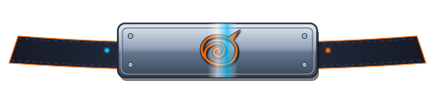

<!-- Naruto-Themed Navigation Bar (Converted from Portfolio Tabs) -->

  
  
  
  
  
  

  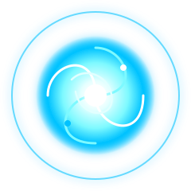

  

  

<code>[ <a href="#idcard">🥷</a> ] &nbsp; [ <a href="#jutsu">📜</a> ] &nbsp; [ <a href="#stack">🛠️</a> ] &nbsp; [ <a href="#missions">🎯</a> ] &nbsp; [ <a href="#stats">🏆</a> ] &nbsp; [ <a href="#strike">💥</a> ] &nbsp; [ <a href="#journey">🗺️</a> ] &nbsp; [ <a href="#contact">🦅</a> ] &nbsp; [ <a href="#top">▲</a> ]</code>

  

 

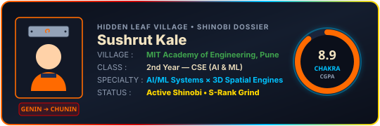

  

 


  

  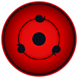

 

<!-- Complete Verified Tech Stack Icons Grid (Reference: Portfolio Architecture) -->

  

 

<!-- Categorized Domain Matrix -->
<table align="center" border="0" cellpadding="6" cellspacing="0">
  <tr>
    <td align="left"><b>Languages</b></td>
    <td align="left">
      
      
      
      
      
      
      
    </td>
  </tr>
  <tr>
    <td align="left"><b>Frontend &amp; 3D</b></td>
    <td align="left">
      
      
      
      
      
    </td>
  </tr>
  <tr>
    <td align="left"><b>Backend &amp; APIs</b></td>
    <td align="left">
      
      
      
      
      
    </td>
  </tr>
  <tr>
    <td align="left"><b>AI/ML &amp; Vision</b></td>
    <td align="left">
      
      
      
      
      
      
    </td>
  </tr>
  <tr>
    <td align="left"><b>Databases &amp; Cloud</b></td>
    <td align="left">
      
      
      
      
      
      
    </td>
  </tr>
</table>

 

 

<!-- S-RANK PROJECTS (God Tier / Spatial & Autonomous Multi-Agent AI) -->
<table align="center" border="0" cellpadding="6" cellspacing="0">
  <tr>
    <td align="center">
      
    </td>
    <td align="center">
      <a href="https://agentcraft-phi.vercel.app">
        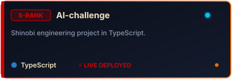
      </a>
    </td>
  </tr>
  <tr>
    <td align="center">
      <a href="https://finpath-ai-three.vercel.app/">
        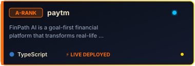
      </a>
    </td>
    <td align="center">
      <a href="https://ai-learning-conductor.vercel.app/">
        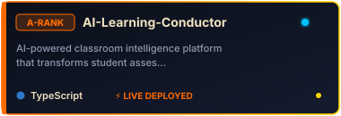
      </a>
    </td>
  </tr>
</table>

 

<!-- A-RANK PROJECTS (Constraint Solvers, Explainable AI & Growth Platforms) -->
<table align="center" border="0" cellpadding="6" cellspacing="0">
  <tr>
    <td align="center">
      <a href="https://github.com/Sushrut-Kale/timetable">
        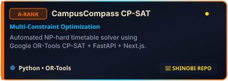
      </a>
    </td>
    <td align="center">
      <a href="https://hbtm-delta.vercel.app">
        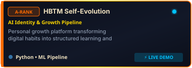
      </a>
    </td>
  </tr>
  <tr>
    <td align="center">
      <a href="https://farm-friend-chi.vercel.app">
        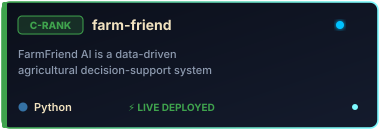
      </a>
    </td>
    <td align="center">
      <a href="https://clubsync-4qua.vercel.app/">
        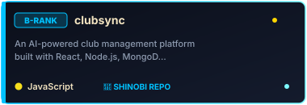
      </a>
    </td>
  </tr>
</table>

 

<!-- B-RANK PROJECTS (Motion Design, Route Search & Math Engines) -->
<table align="center" border="0" cellpadding="6" cellspacing="0">
  <tr>
    <td align="center">
      <a href="https://portfolio-seven-omega-o9wgw7dd59.vercel.app/">
        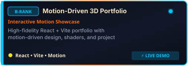
      </a>
    </td>
    <td align="center">
      <a href="https://github.com/Sushrut-Kale/maze_AI">
        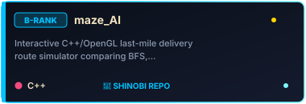
      </a>
    </td>
  </tr>
</table>

 

  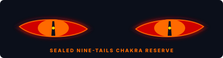

 

<table align="center" border="0" cellpadding="4" cellspacing="0">
  <tr>
    <td align="center">
      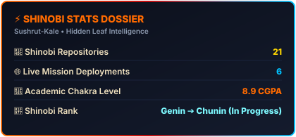
    </td>
    <td align="center">
      
    </td>
  </tr>
</table>

 

  

 

<!-- Real Verified Live Contribution Heatmap with Naruto Snake Animation -->

  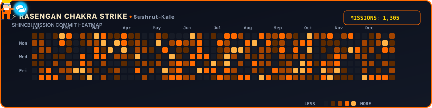

 

 

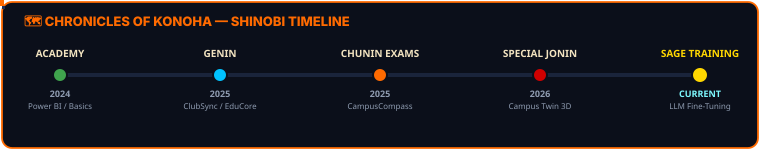

  

 

  

  
  
  
  
  
  

  

